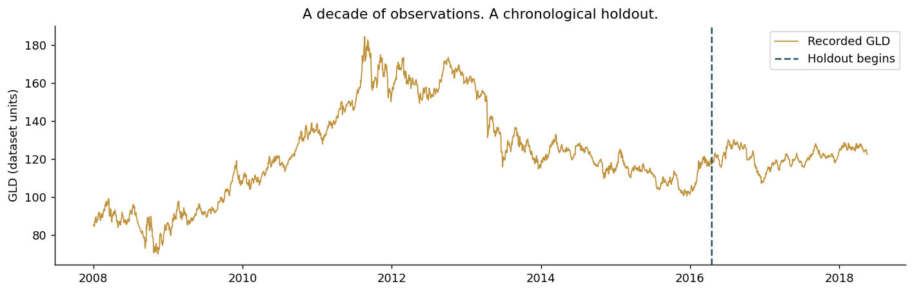
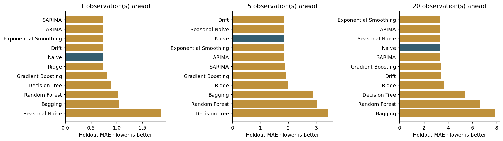
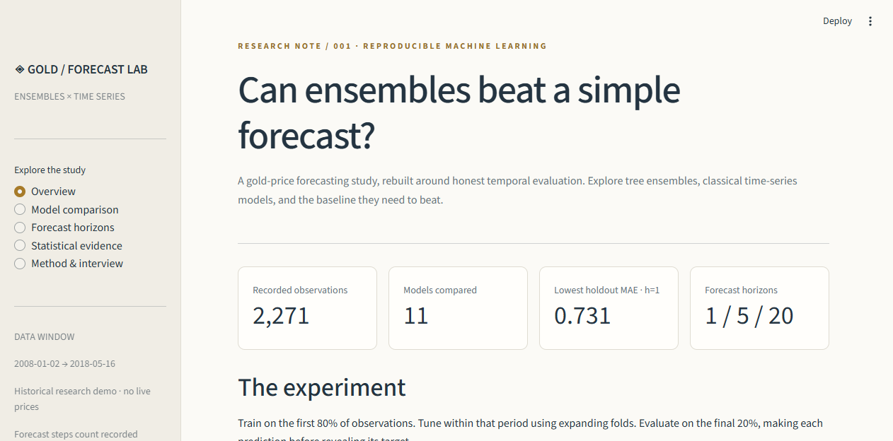

# Gold Forecast Lab

**Can ensemble learning forecast gold better than a no-change baseline?**

A complete, reproducible reconstruction of *Modeling Gold Price Movements with Ensemble Learning Methods*, extended with **ARIMA, SARIMA and exponential smoothing**, and evaluated at **1-, 5- and 20-observation horizons**.

This project turns a report and incomplete code appendix into an executable research package: chronological model selection, causal feature engineering, matched forecast comparisons, uncertainty analysis, tests and an interactive dashboard.



## Start here

- **[Results and measured model comparisons](artifacts/RESULTS.md)**
- **[Executed notebook](notebooks/01_gold_forecasting.ipynb)**
- **[Methodology and evaluation contract](docs/METHODOLOGY.md)**
- **[Three-minute explanation and interview questions](docs/INTERVIEW_GUIDE.md)**
- **[What was fixed in the original project](docs/DOCUMENT_AUDIT.md)**

## Run locally

Python 3.11+ is supported; the included experiment was run with Python 3.13.2. Run commands from this repository's root.

```bash
python -m venv .venv
```

Activate with `.venv\Scripts\Activate.ps1` on Windows PowerShell, or `source .venv/bin/activate` on macOS/Linux. Then:

```bash
python -m pip install -r requirements.txt
python -m streamlit run app.py
```

The committed results make the dashboard usable immediately. No API keys or live data downloads are needed. To rebuild the full experiment:

```bash
python -m gold_forecast run
```

To run a smaller search without replacing the full results:

```bash
python -m gold_forecast run --quick --output artifacts/smoke
```

## What is implemented

| Original study | Rebuilt and extended |
| --- | --- |
| Dataset summaries, outliers and correlations | Validated data, training-only EDA and regenerated figures |
| Decision tree, bagging, Random Forest | Reproducible estimators, pruning and temporal hyperparameter search |
| Brief gradient-boosting discussion | An implemented gradient-boosting comparator |
| One-observation forecasting | Direct 1-/5-/20-step ML models |
| No classical comparison | ARIMA, SARIMA and additive exponential smoothing |
| Accuracy judged mostly by R² | MAE, MSE, RMSE, MASE, direction accuracy and skill versus Naive |
| Feature-removal experiment | Corrected ablation, paired loss intervals and exploratory tests |
| Incomplete appendix | Package, CLI, notebook, dashboard, tests and GitHub Actions |

**11 models:** Naive, Drift, Seasonal Naive, Ridge, Decision Tree, Bagging, Random Forest, Gradient Boosting, ARIMA, SARIMA and Exponential Smoothing. The separate paper reconstruction retains all seven original inputs; the main benchmark excludes macro series whose historical publication timing is unknown.

## Honest evaluation

The first 80% of observations is development data. Three expanding folds select hyperparameters; the final 20% is held out. Features use only history through the forecast origin. Multi-step training labels and validation folds respect the horizon boundary. Every model sees the same holdout target/origin pairs at each horizon.

Classical filters update as new observations arrive, with parameters fixed during evaluation. Ensembles make direct h-step predictions, without assuming future market covariates are known. We report the unchanged-price baseline prominently because persistent price levels can produce impressive R² without useful forecasting skill.



Read the [generated results](artifacts/RESULTS.md) for actual scores and [paired loss intervals](artifacts/paired_comparisons.csv) for uncertainty. The original paper's reported metrics are not presented as newly reproduced results. The best retrospective test score is not a deployment selection rule.

Selected one-step results from the full run (455 held-out targets):

| Model | MAE | Skill versus Naive |
| --- | ---: | ---: |
| SARIMA | 0.7305 | +0.41% |
| ARIMA | 0.7310 | +0.34% |
| Exponential Smoothing | 0.7312 | +0.32% |
| Naive | 0.7336 | 0.00% |
| Random Forest | 1.0233 | −39.50% |

The classical models' small improvements have paired block-bootstrap intervals spanning zero. **This study does not establish a clear improvement over persistence.** That is a useful result: adding a credible baseline changes the conclusion drawn from a high R² alone.

## Dashboard



Explore model predictions, horizon-dependent errors, classical prediction intervals, feature ablation and the experiment's exact settings. Use the download controls to export the result report and individual forecasts.

## Data and limits

`main.csv` contains 2,271 irregularly dated observations from **2008-01-02 to 2018-05-16**. Fields are GLD, SPX, USO, SLV, EUR/USD, EFFR and a derived daily-inflation field. GLD is treated as the supplied gold-price proxy; the file does not verify the report's “daily high” claim or establish spot-gold units.

Horizon steps count recorded observations, not calendar days. The dashboard is historical and shows no live prices. Original provider, redistribution terms, market timestamps and macro vintages are undocumented; see the [data card](docs/DATA_CARD.md). Adding classical models does not remove regime risk, establish a profitable trading strategy, or guarantee improvement.

## Repository guide

```text
gold_forecast/        Validated data, models, evaluation, diagnostics, reporting, CLI
app.py               Interactive Streamlit research dashboard
main.csv             Original supplied dataset
artifacts/           Generated metrics, predictions, settings, uncertainty and figures
notebooks/           Executed research walkthrough
docs/                Methodology, source audit, data card, interview and publishing guides
tests/               Leakage, forecasting, data-quality, artifact and dashboard checks
scripts/             Rebuild the executed notebook from experiment outputs
.github/workflows/   Automated verification; optional full reproduction job
```

Model binaries are generated locally in `artifacts/models/` and ignored by Git. Original PDF/LaTeX/image submissions remain untouched locally and are excluded from publishing; their title pages contain student identifiers and inconsistent credits.

## Verify

```bash
python -m pip install -r requirements-dev.txt
python -m ruff check gold_forecast app.py tests scripts
python -m pytest -q
python scripts/build_notebook.py
```

Tests verify that future-value mutations cannot change earlier features or forecasts, training labels cannot cross temporal boundaries, invalid data is rejected, smoothing states update correctly, metrics recompute from saved forecasts, and dashboard controls work. The full run records data SHA-256, seed, package versions, chosen settings and optimizer warnings in `artifacts/metadata.json` and associated CSV files.

The implementation follows the official [scikit-learn temporal split documentation](https://scikit-learn.org/stable/modules/generated/sklearn.model_selection.TimeSeriesSplit.html) and [statsmodels rolling forecast evaluation guide](https://www.statsmodels.org/stable/examples/notebooks/generated/statespace_forecasting.html).
