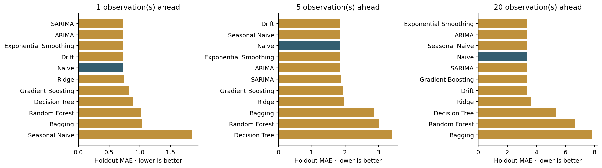

# Experiment results

Generated from `main.csv`; SHA-256 `a7c9b1475b0b85eae5def5842639093e5e9f70f349cde9edaaa74503e6241470`.
Seed 42. 2271 observations; 2008-01-02 to 2018-05-16.
Training ends 2016-04-13; holdout starts 2016-04-14.

## One-observation-ahead benchmark

| model | mae | rmse | r2 | mase | skill_vs_naive |
| --- | --- | --- | --- | --- | --- |
| SARIMA | 0.7305 | 0.9979 | 0.9577 | 0.6416 | 0.0041 |
| ARIMA | 0.7310 | 0.9976 | 0.9577 | 0.6421 | 0.0034 |
| Exponential Smoothing | 0.7312 | 0.9977 | 0.9577 | 0.6422 | 0.0032 |
| Drift | 0.7332 | 0.9983 | 0.9577 | 0.6439 | 0.0005 |
| Naive | 0.7336 | 0.9983 | 0.9577 | 0.6443 | 0.0000 |
| Ridge | 0.7355 | 1.0066 | 0.9570 | 0.6460 | -0.0026 |
| Gradient Boosting | 0.8199 | 1.0922 | 0.9493 | 0.7201 | -0.1177 |
| Decision Tree | 0.8926 | 1.1945 | 0.9394 | 0.7839 | -0.2168 |
| Random Forest | 1.0233 | 1.3186 | 0.9262 | 0.8987 | -0.3950 |
| Bagging | 1.0419 | 1.3546 | 0.9221 | 0.9151 | -0.4203 |
| Seasonal Naive | 1.8549 | 2.3079 | 0.7738 | 1.6291 | -1.5286 |

The lowest observed holdout MAE is **SARIMA (0.7305)**.
This is a retrospective ranking, not evidence of future superiority. Hyperparameters were
selected using development data only. Negative skill means worse than the unchanged-price baseline.
High R² on persistent price levels alone is not evidence of a useful trading strategy.

## Longer horizons

| model | horizon | mae | rmse | skill_vs_naive |
| --- | --- | --- | --- | --- |
| Drift | 5.0000 | 1.8618 | 2.3163 | 0.0021 |
| Naive | 5.0000 | 1.8656 | 2.3171 | 0.0000 |
| Seasonal Naive | 5.0000 | 1.8656 | 2.3171 | 0.0000 |
| Exponential Smoothing | 5.0000 | 1.8666 | 2.3192 | -0.0005 |
| ARIMA | 5.0000 | 1.8666 | 2.3191 | -0.0005 |
| SARIMA | 5.0000 | 1.8694 | 2.3213 | -0.0020 |
| Gradient Boosting | 5.0000 | 1.9324 | 2.4018 | -0.0358 |
| Ridge | 5.0000 | 1.9776 | 2.5154 | -0.0600 |
| Bagging | 5.0000 | 2.8715 | 3.3699 | -0.5392 |
| Random Forest | 5.0000 | 3.0309 | 3.5222 | -0.6246 |
| Decision Tree | 5.0000 | 3.4056 | 4.1545 | -0.8254 |
| Exponential Smoothing | 20.0000 | 3.3670 | 4.3155 | 0.0009 |
| ARIMA | 20.0000 | 3.3671 | 4.3155 | 0.0009 |
| Naive | 20.0000 | 3.3700 | 4.3171 | 0.0000 |
| Seasonal Naive | 20.0000 | 3.3700 | 4.3171 | 0.0000 |
| SARIMA | 20.0000 | 3.3723 | 4.3203 | -0.0007 |
| Gradient Boosting | 20.0000 | 3.3750 | 4.2581 | -0.0015 |
| Drift | 20.0000 | 3.3823 | 4.3132 | -0.0036 |
| Ridge | 20.0000 | 3.6580 | 4.6730 | -0.0855 |
| Decision Tree | 20.0000 | 5.3685 | 6.6026 | -0.5930 |
| Random Forest | 20.0000 | 6.6548 | 7.4233 | -0.9747 |
| Bagging | 20.0000 | 7.8328 | 8.6647 | -1.3243 |

Every horizon is evaluated on identical origins/targets across models. ML models make direct
h-step predictions; classical models propagate states without seeing intermediate future values.
Longer horizons have fewer eligible targets. Horizons count recorded observations, not calendar days.

## Corrected paper reconstruction

| model | mae | mse | r2 |
| --- | --- | --- | --- |
| Decision Tree | 1.4256 | 3.8020 | 0.8385 |
| Bagging (12 trees) | 1.0647 | 1.8639 | 0.9208 |
| Random Forest (50 trees, appendix) | 1.0111 | 1.6642 | 0.9293 |
| Random Forest (30 trees, narrative) | 4.6044 | 32.0108 | -0.3595 |

This separate experiment uses only origin-time GLD, SPX, USO, SLV, EUR/USD, EFFR and inflation,
with the paper's 12-tree bagging and 50-tree Random Forest appendix settings, plus 30-tree
Random Forest from the narrative. Macro release timing is unverified. These are new measured
results, not a claim to reproduce the paper's reported numbers exactly.

## Statistical evidence and caveats

- `ablation.csv`: remove one input at a time, refit, compare absolute errors on a development
  validation block. Positive delta means removal hurts. Block-bootstrap intervals account for
  local dependence approximately. Wilcoxon/Holm values are exploratory because errors are serially dependent.
- `paired_comparisons.csv`: holdout paired absolute-loss differences versus Naive, with circular
  block-bootstrap intervals. Not a multiple-comparison-controlled winner selection procedure.
- `interval_coverage.csv`: empirical coverage and width of classical 95% model-based intervals.
  These intervals depend on model assumptions and do not include parameter-selection uncertainty.
- `stationarity.csv`, `residual_diagnostics.csv`: ADF and residual Ljung–Box diagnostics.
  Multi-step errors overlap, so their Ljung–Box p-values are descriptive only.
- Main benchmark excludes macro fields whose historical release availability is unknown.
  Market close alignment, source provenance and missing dates still limit real-world interpretation.
- See `metadata.json` for settings, selected parameters, versions and data hash;
  `classical_candidates.csv` records failed candidates and optimizer warnings explicitly.
